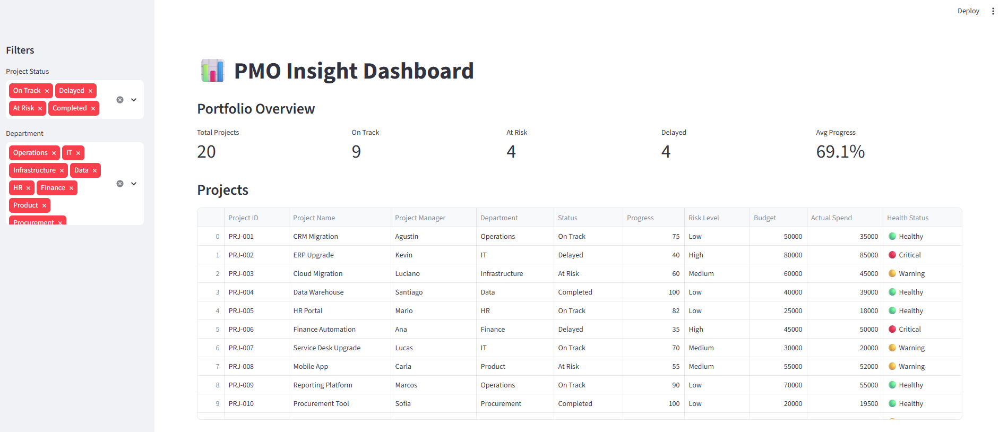
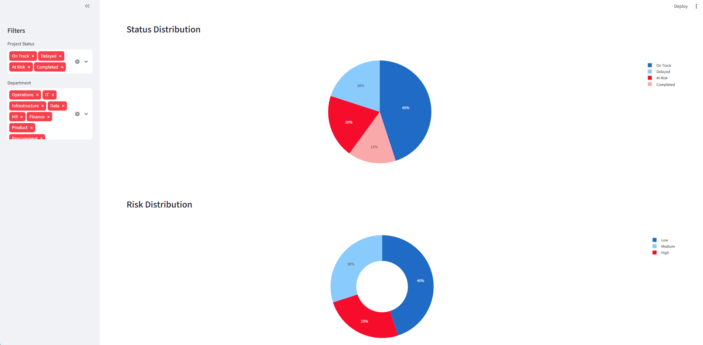
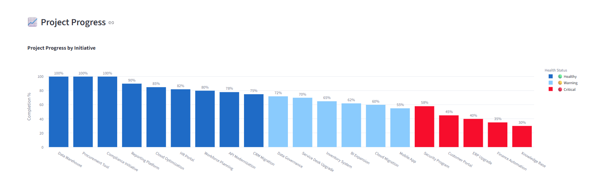
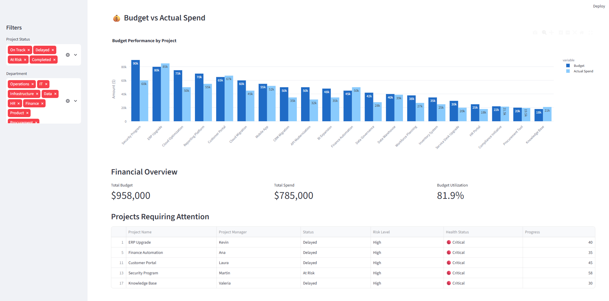

# 📊 PMO Insight Dashboard



Interactive project portfolio dashboard built with Python, Streamlit, Pandas and Plotly.

The PMO Insight Dashboard provides a centralized view of project performance, portfolio risks, budget utilization and delivery progress through interactive analytics and executive KPI reporting.

## 🚀 Live Demo

https://https://pmo-insight-dashboard.streamlit.app/

Interactive project portfolio dashboard built with Python, Streamlit, Pandas and Plotly.
---

## 🚀 Features

### Portfolio Overview

- Total Projects
- On Track Projects
- At Risk Projects
- Delayed Projects
- Average Progress (%)

### Risk Analysis

- Project Status Distribution
- Risk Level Distribution
- Project Health Classification
  - 🟢 Healthy
  - 🟡 Warning
  - 🔴 Critical

### Progress Monitoring

- Progress by Project
- Project Completion Comparison
- Health Status Visualization

### Financial Analysis

- Budget vs Actual Spend
- Total Portfolio Budget
- Total Portfolio Spend
- Budget Utilization %

### Project Governance

- Interactive Portfolio Table
- Department Filtering
- Status Filtering
- Projects Requiring Attention

---

## 🛠 Tech Stack

- Python
- Streamlit
- Pandas
- Plotly Express

---

## 📂 Project Structure

```text
pmo-insight-dashboard/
│
├── data/
│   └── sample_projects.csv
│
├── app.py
├── requirements.txt
├── README.md
└── LICENSE
```

---

## ▶️ Installation

Clone the repository:

```bash
git clone https://github.com/agusceriati/pmo-insight-dashboard.git
```

Move to the project folder:

```bash
cd pmo-insight-dashboard
```

Install dependencies:

```bash
pip install -r requirements.txt
```

Run the application:

```bash
streamlit run app.py
```

---

## 📈 Dashboard Sections

1. Portfolio Overview
2. Status Distribution
3. Risk Distribution
4. Project Progress Analysis
5. Budget vs Actual Spend Analysis
6. Financial Overview
7. Projects Requiring Attention

---

## 📸 Screenshots

### Dashboard Overview

 

Portfolio KPIs, project tracking and executive reporting.

---

### Risk Analysis



Project status distribution and portfolio risk monitoring.

---

### Progress Analysis



Project completion tracking with health status indicators.

---

### Financial Analysis



Budget versus actual spend analysis, portfolio financial metrics and projects requiring attention.


## 🎯 Business Value

This dashboard helps Project Management Offices (PMOs) monitor project performance, identify risks, track budget consumption and improve executive decision-making through real-time portfolio visibility.

---

## 🔮 Future Enhancements

- Department Performance Analytics
- Portfolio Forecasting Metrics
- Export to PDF Reporting
- Cloud Deployment via Streamlit Community Cloud

---

## 👤 Author

**Agustín Ceriati**

Project Portfolio Analytics | PMO Reporting | Data Analytics